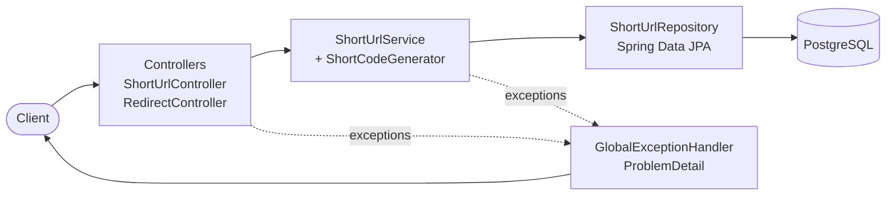
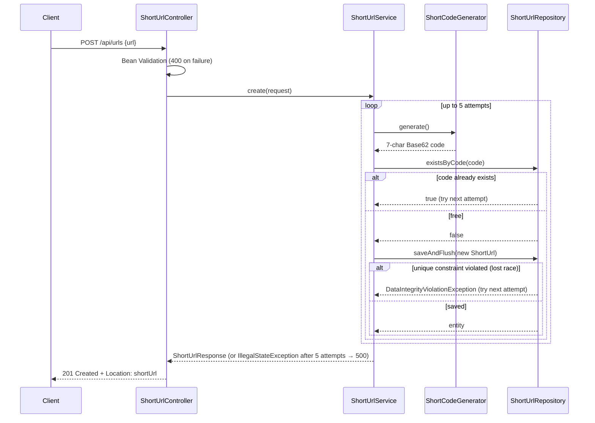
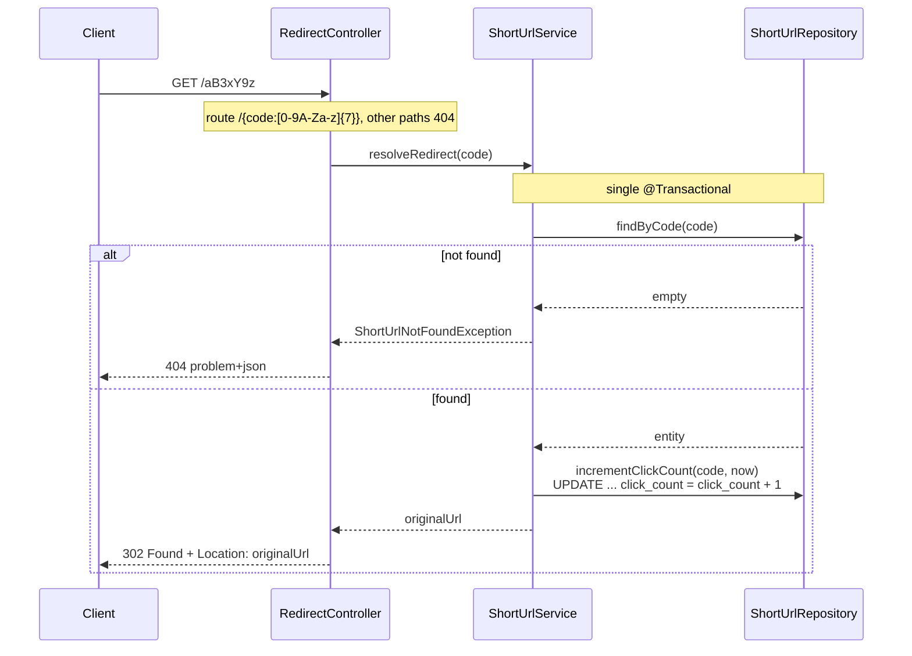

# URL Shortener


A REST API that turns long http/https URLs into 7-character short links, redirects them with an HTTP 302 and counts every click. It is a small service built to show production-style Spring Boot practice: layered design, Bean Validation, RFC 9457 error responses, schema migrations with Flyway, race-safe code generation, atomic click counting, OpenAPI docs, a layered test suite on a real PostgreSQL (Testcontainers) and a containerized deployment.

## Features

- **Create** short links for http/https URLs (`POST /api/urls`, 201 + `Location`).
- **Redirect** with `302 Found` (`GET /{code}`).
- **Click statistics**: click count, creation and last-access time (`GET /api/urls/{code}/stats`).
- **Validation**: required, max 2048 chars, http/https only; surrounding whitespace is stripped.
- **RFC 9457 errors** (`application/problem+json`) for every failure, including Spring's own 404/405/415.
- **Race-safe code generation**: collision pre-check plus a unique DB constraint and retry.
- **Atomic click counting**: one SQL `UPDATE`, no lost updates under concurrency.
- **OpenAPI / Swagger UI** generated from the code.

## Tech stack

| Technology | Purpose | Why chosen |
|------------|---------|------------|
| Java 21 | Language/runtime | Current LTS; records for DTOs |
| Spring Boot 4.2 (MVC) | Web framework | Standard for Java REST services; auto-configuration |
| Spring Data JPA / Hibernate | Persistence | Repository abstraction with little boilerplate |
| PostgreSQL 18 | Database | Reliable, strong constraint and transaction support |
| Flyway | Schema migrations | Versioned, reviewable schema; Hibernate only validates |
| Bean Validation | Request validation | Declarative rules on the request record |
| springdoc-openapi 3.2.1 | API docs | Swagger UI and OpenAPI JSON from the code |
| JUnit 5, Mockito, MockMvc | Unit and web tests | Fast tests without a full stack |
| Testcontainers | Integration tests | Tests run against real PostgreSQL |
| JaCoCo | Coverage | Report generated on `./mvnw test` |
| Docker, Docker Compose | Packaging | Multi-stage image; one command runs app + DB |

## Architecture



- **Controllers** (`controller`): HTTP concerns only: routing, validation trigger, status codes. No business logic.
- **Service** (`service`): code generation and collision handling, click counting, transactions, entity → DTO mapping.
- **Repository** (`repository`): Spring Data JPA, including the atomic click-increment query.
- **Entity / DTOs**: the `ShortUrl` entity stays inside the service; the API uses Java records.
- **GlobalExceptionHandler**: turns every exception into a `ProblemDetail` response.

## Request flows

### `POST /api/urls`: create, with collision retry



### `GET /{code}`: redirect with transactional click increment



## Quick start

**Prerequisites:** Docker (with Compose). Java is not needed to run the container.

```bash
docker compose up --build
```

This builds the image, starts PostgreSQL 18 and the app, and waits for the database to be healthy. The API is then on <http://localhost:8080>.

```bash
# Create a short link
curl -i -X POST http://localhost:8080/api/urls \
  -H 'Content-Type: application/json' \
  -d '{"url":"https://example.com/some/long/path"}'
```

```http
HTTP/1.1 201
Location: http://localhost:8080/aB3xY9z
Content-Type: application/json

{"code":"aB3xY9z","shortUrl":"http://localhost:8080/aB3xY9z","originalUrl":"https://example.com/some/long/path","createdAt":"2026-11-25T10:30:00.123456Z"}
```

```bash
# Follow it (302)
curl -i http://localhost:8080/aB3xY9z
```

```http
HTTP/1.1 302
Location: https://example.com/some/long/path
```

```bash
# Click statistics
curl -i http://localhost:8080/api/urls/aB3xY9z/stats
```

```http
HTTP/1.1 200
Content-Type: application/json

{"code":"aB3xY9z","shortUrl":"http://localhost:8080/aB3xY9z","originalUrl":"https://example.com/some/long/path","clickCount":1,"createdAt":"2026-11-25T10:30:00.123456Z","lastAccessedAt":"2026-11-25T10:35:10.654321Z"}
```

Swagger UI: <http://localhost:8080/swagger-ui.html> · OpenAPI JSON: <http://localhost:8080/v3/api-docs>

Stop with `docker compose down` (add `-v` to also delete the database volume).

## Local development

Prerequisites: Java 21 and Docker. Run only PostgreSQL in Docker and the app from Maven:

```bash
docker compose up -d postgres
./mvnw spring-boot:run
```

Flyway applies the migrations on startup. Configuration comes from `application.properties` and can be overridden by environment variables:

| Variable | Default | Purpose |
|----------|---------|---------|
| `SERVER_PORT` | `8080` | HTTP port |
| `DB_URL` | `jdbc:postgresql://localhost:5432/urlshortener` | JDBC URL (compose sets `jdbc:postgresql://postgres:5432/urlshortener` for the app container) |
| `DB_USERNAME` | `urlshortener` | Database user (also used by the compose `postgres` service) |
| `DB_PASSWORD` | `urlshortener` | Database password (also used by the compose `postgres` service) |
| `APP_BASE_URL` | `http://localhost:8080` | Base used to build `shortUrl` (trailing slash is stripped) |

The defaults are for local development only.

## API overview

| Method | Path | Success | Error statuses |
|--------|------|---------|----------------|
| `POST` | `/api/urls` | `201 Created` | `400` (validation, malformed JSON), `415`, `500` |
| `GET` | `/{code}` | `302 Found` | `404` (unknown code, or not 7 alphanumerics) |
| `GET` | `/api/urls/{code}/stats` | `200 OK` | `404` |
| `GET` | `/api/health` | `200 OK` | n/a |

`code` is exactly 7 characters of `[0-9A-Za-z]`. Interactive docs: [Swagger UI](http://localhost:8080/swagger-ui.html) (when running). Details and examples: [API_DOCUMENTATION.md](API_DOCUMENTATION.md).

## Error format

Every error is a [RFC 9457](https://www.rfc-editor.org/rfc/rfc9457) `ProblemDetail`. Validation failure on `POST /api/urls` with `{"url":"ftp://x.com"}`:

```json
{
  "detail": "Validation failed",
  "instance": "/api/urls",
  "status": 400,
  "title": "Bad Request",
  "errors": [{ "field": "url", "message": "must be an http or https URL" }]
}
```

## Testing

Docker must be running: DB-backed tests share one static PostgreSQL 18 Testcontainers container.

```bash
./mvnw test                                   # all tests + JaCoCo report
./mvnw test -Dtest=ShortUrlServiceTest        # one class
open target/site/jacoco/index.html            # coverage report
```

| Type | Classes | Notes |
|------|---------|-------|
| Unit (Mockito) | `ShortUrlServiceTest`, `ShortCodeGeneratorTest` | No Spring context; includes collision-retry and unique-violation retry cases |
| Web slice (`@WebMvcTest`, MockMvc) | `HealthControllerTest`, `RedirectControllerTest`, `ShortUrlControllerTest`, `GlobalExceptionHandlerTest` | Service mocked |
| Repository (`@DataJpaTest`) | `ShortUrlRepositoryTest` | Real PostgreSQL + Flyway |
| Integration (`@SpringBootTest` + MockMvc + Testcontainers) | `ShortUrlCreationIntegrationTest`, `RedirectIntegrationTest`, `StatsIntegrationTest`, `OpenApiDocsIntegrationTest`, `UrlShortenerApplicationTests` | Full stack, one cached context |
| Concurrency | `StatsIntegrationTest#concurrentRedirectsAreAllCounted` | 20 simultaneous redirects, all counted |

**Latest run** (`./mvnw clean test`): 59 tests, 0 failures. JaCoCo: 91.5% line coverage (97 of 106 lines), 59.4% branch coverage.

## Project structure

```text
src/
├── main/
│   ├── java/com/learninglab/urlshortener/
│   │   ├── UrlShortenerApplication.java
│   │   ├── config/        OpenAPI metadata
│   │   ├── controller/    REST endpoints (create, redirect, stats, health)
│   │   ├── service/       Business logic, short code generation
│   │   ├── repository/    Spring Data JPA repository
│   │   ├── entity/        JPA entity (ShortUrl)
│   │   ├── dto/           Request/response records
│   │   └── exception/     ShortUrlNotFoundException, GlobalExceptionHandler
│   └── resources/
│       ├── application.properties
│       └── db/migration/  Flyway: V1 create table, V2 click counting
└── test/java/com/learninglab/urlshortener/
    ├── (integration tests, TestcontainersConfiguration)
    ├── controller/        Web slice tests
    ├── repository/        @DataJpaTest
    └── service/           Mockito unit tests
Dockerfile · docker-compose.yml · pom.xml
```

## Key design decisions

- **302, not 301**: browsers cache 301s, so later clicks would skip the server and never be counted.
- **Base62 codes from `SecureRandom`**: 7 chars give 62^7 ≈ 3.5 trillion codes and are not guessable in sequence.
- **The DB unique constraint is the real guard**: `existsByCode` is only an optimization; a lost race surfaces as `DataIntegrityViolationException` and is retried (5 attempts shared).
- **Atomic `UPDATE` for clicks**: `click_count = click_count + 1` in SQL avoids the lost updates of read-modify-write.
- **`create` is not `@Transactional`**: a failed INSERT aborts the Postgres transaction, so each retry must run in its own transaction.
- **Flyway + `ddl-auto=validate`**: the schema is versioned in SQL; Hibernate only checks the entity matches.
- **DTOs instead of entities**: the API contract is decoupled from the table; mapping lives in the service.

## Possible extensions

- Link expiry (`expires_at`, 404/410 after expiry)
- Custom alias (optional alias at creation, 409 on conflict)
- Rate limiting on `POST /api/urls` (429)

## Documentation index

| File | Contents |
|------|----------|
| [PROJECT_OVERVIEW.md](PROJECT_OVERVIEW.md) | Scope, stack and package map in one page |
| [ARCHITECTURE.md](ARCHITECTURE.md) | Layers, error handling, transaction rules, deployment |
| [DATABASE_DESIGN.md](DATABASE_DESIGN.md) | ER diagram, both migrations, constraints |
| [API_DOCUMENTATION.md](API_DOCUMENTATION.md) | Every endpoint: request, response, statuses, curl |
| [LEARNING_NOTES.md](LEARNING_NOTES.md) | Concepts per milestone with Node/Express comparisons |
| [PROGRESS.md](PROGRESS.md) | Milestone status and optional extensions |
| [INTERVIEW_PREPARATION.md](INTERVIEW_PREPARATION.md) | Practical Q&A based on this codebase |
| [CLAUDE.md](CLAUDE.md) | Guidance for Claude Code working in this repo |
